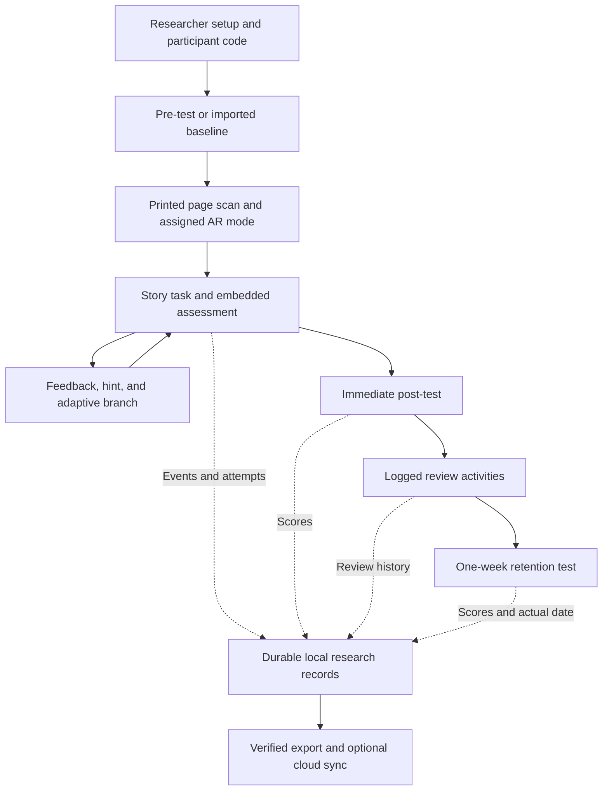

# App Improvement Report: The Secret of Lost Temple 2

**Prepared:** 13 October 2026  
**Basis:** The three proposal summaries, current Unity C# scripts, scene references, and package manifest.  
**Review type:** Static requirements and implementation analysis. No Unity build, Play Mode session, live Firebase inspection, or physical-device AR test was performed for this report.

## 1. Overall assessment

Continue developing the existing application. The Unity project already has useful foundations: a temple story, characters, a home map, marker-related AR code, a lever simulation, force visualization, quizzes, hints, and research-related classes.

However, it is not ready to collect dependable research evidence. Some displayed results are fixed demonstration values; several data services are incomplete; the interaction modes differ from the proposed definitions; and adaptive difficulty does not yet drive a complete adaptive narrative.

The next development milestone should be one complete, verifiable learning session that supports all three components. Then extend that working flow across the agreed machine chapters.

This report distinguishes **proposal requirements**, **observed implementation gaps**, and **recommended engineering choices**. New class names, schemas, example adaptation thresholds, and acceptance checks below are recommendations rather than additional requirements claimed to appear in the proposals.

### Source proposals

- [Abeywickrama: adaptive storytelling](<C:/Users/thenn/OneDrive/Desktop/the secret of lost temple/The secret of lost temple 2/proposals/abeywickrama-adaptive-storytelling.md>)
- [Kalish: AR interaction](<C:/Users/thenn/OneDrive/Desktop/the secret of lost temple/The secret of lost temple 2/proposals/kalish-ar-interaction.md>)
- [Pathirana: assessment and retention](<C:/Users/thenn/OneDrive/Desktop/the secret of lost temple/The secret of lost temple 2/proposals/pathirana-assessment-retention.md>)

## 2. What to keep

- Keep Unity 6000.0.60f1 and the existing project structure for this work unless a demonstrated compatibility issue requires a change.
- Reuse the temple narrative, Maya/Senuk art and voices, storybook presentation, and map.
- Reuse the lever models, physics calculations, force indicators, and existing UI where they support the requirements.
- Keep useful quiz content, but have the students/teacher review its scientific accuracy and suitability for approximately ten-year-old learners.
- Keep Firebase as an optional backend if wanted; reliable local research records should not depend on successful cloud connectivity.
- Keep the sandbox as an exploration feature, but distinguish it from measured study sessions and label its data accordingly.

Existing code is a starting point, not proof that each feature works on the target phones.

## 3. Requirements and current gaps

| Component | Proposal requirement | Current evidence | Required action |
|---|---|---|---|
| Shared AR | Printed page loads its associated machine/activity | Quest spawner has a lever prefab and a fallback that accepts the first other image | Add explicit marker-to-chapter mapping and validate each chapter. |
| Kalish | Passive observation versus interactive manipulation | Viewer permits drag rotation in view-only and locks interactive yaw | Make input permissions match the two study conditions. |
| Kalish | Rotation, force application, animation, visual cues | Lever controls and force visualization exist | Verify all controls and implement equivalent agreed content for other machines. |
| Kalish | Interaction and learning evidence | Logger exists, but startup wiring and event persistence are incomplete | Start sessions explicitly and preserve raw events and condition data. |
| Abeywickrama | Performance changes difficulty | Success/failure changes a tier | Apply the selected difficulty to the actual learning task. |
| Abeywickrama | Performance-driven narrative branches | Story nodes branch mainly from clicked choices | Connect task outcomes and support needs to narrative transitions. |
| Abeywickrama | Contextual hints and engagement tracking | Hint UI exists; engagement service has placeholder sync | Connect real hint events, task timing, navigation, and storage. |
| Pathirana | Embedded assessment with corrective guidance | Quiz exposes the correct answer after an error | Provide guidance and retry before revealing a solution. |
| Pathirana | Review completed concepts and quizzes | Review button opens an exploded view of a failed part | Add chapter-based review activities and record review exposure. |
| Pathirana | Pre-test, immediate post-test, one-week test | Test entry methods exist; full sequence and retention summaries are unfinished | Add assessment stages or import external scores against stable participant IDs. |
| Shared data | Accurate, anonymous research records | Fixed dashboard values, temporary IDs, shared preferences | Replace demonstration data and implement participant/session isolation. |

## 4. Highest-priority changes

**P0 = required before collecting real participant data. P1 = required to fulfil the proposed learning experience. P2 = improvements after the core flow works.**

### P0-01 — Replace invented or demonstration results

**Observed:** The home dashboard contains fixed accuracy, response-time, pre/post-test, and retention values. The lever assessment and retention screens display fixed learning gains and statements about beating a textbook baseline.

**Change:** Bind every number to stored measurements. Display `Not collected`, `No session`, or `Pending retention test` when appropriate. Remove claims of significance or superiority unless they come from an actual completed analysis. Show cloud-sync success only after an acknowledged successful operation.

**Acceptance:** A new participant has no pre-test, post-test, retention, or learning-gain result until those measurements exist. A disconnected device never displays an unconditional cloud-connected status.

### P0-02 — Add participant and study-session management

**Observed:** Assessment records use `temp_user`; retention storage uses a single `RetentionDataStore` key; difficulty is saved globally; one AR session path uses the device identifier. Usernames and emails are also written to Firebase profiles.

**Add:** Researcher setup with an anonymous participant code, study protocol/version, assigned interaction condition, and session lifecycle. Create the session ID once at the start and reuse it. Keep each participant's progress, scores, and review history separate.

**Change:** Use participant codes for study data. Separate researcher authentication from learner identity. If a private code-to-name register is needed for follow-up, the research team should manage that separately from app telemetry. A device identifier or authentication UID is not a replacement for a study participant model.

**Acceptance:** Participants P001 and P002 can use the same device without inheriting each other's difficulty, answers, story progress, or retention results. Reopening a session preserves its identity.

### P0-03 — Build a real assessment sequence

**Add:** Stages for baseline test, learning, immediate post-test, review, and delayed retention. Store each test attempt separately with date, test version, score denominator, and actual answers when available.

Formal tests can be in-app or entered/imported from the printed sheets/Google Forms allowed in the proposal. If administered outside the app, record the source and administrator confirmation rather than pretending the app collected the answers.

**Change:** Separate formative learning quizzes from formal measurements. Formative quizzes give feedback and retries; formal tests follow the agreed test protocol and should not automatically reveal answers while measurement is underway. Use the learning-session completion timestamp to establish the one-week follow-up schedule.

**Acceptance:** The same participant has distinct pre/post/retention records; missing results remain missing; the delayed test records its actual date and elapsed interval. A late test remains identifiable as late rather than silently becoming an on-time result.

### P0-04 — Repair research storage and exports

**Observed:** `CollectAllData()` leaves pre/post-test score fields unpopulated, calculates gain from those default values, and creates a fresh session ID for each collection. Retention summary calculations are stubs. Engagement sync logs a message without writing the data. The cognitive cloud payload omits the raw event list, and its no-user path does not actually implement the local storage claimed in its message.

**Add:** Durable local storage, an explicit save result, and a retryable cloud upload queue if cloud sync is retained. Preserve raw attempts and events before deriving summaries. Use stable record IDs to make retries safe from duplication.

**Change:** Export stored completed records rather than an incomplete snapshot of live singleton state. Represent absent results explicitly, use consistent numeric formatting, escape CSV fields, and avoid overwriting the only copy of previous exports with a reused filename.

**Acceptance:** Records survive app restart, a temporary loss of internet, and a repeated upload. CSV totals reproduce the saved answers. Two consecutive exports preserve the original session IDs and do not silently lose older sessions.

### P0-05 — Make interaction conditions match the research

**Observed:** `ARMechanismViewer.Update()` enables pinch scaling in both modes, calls drag rotation in view-only mode, and locks yaw in interactive mode. Several controllers independently manage interaction mode.

**Change:** Define one authoritative interaction policy. In measured passive sessions, learners observe a standardized demonstration without rotating or changing the model. In interactive sessions, enable the proposed rotation, force application, and motion controls. Keep normal camera movement distinct from manipulation of the virtual mechanism.

**Add:** Researcher-controlled condition assignment and a measured-session lock. Free mode switching can remain available in an explicitly separate practice/sandbox session. Record condition and any permitted transition.

**Acceptance:** Touch gestures cannot manipulate the model during a passive study session. Interactive learners can perform each promised action, and events identify the correct condition.

## 5. Additions for Abeywickrama

### P1-01 — Apply adaptive difficulty to real tasks

The current engine promotes after three consecutive successes and demotes after two failures. Those thresholds are implementation choices, not proposal-mandated values. Its profile fields describe complexity, timing, parts, and hints, but the reviewed consumers mainly retrieve tier names for presentation/export.

Connect the profile to meaningful task parameters: number of guided steps, force/load choices, conceptual question difficulty, and the amount of scaffolding. Avoid defining a harder task solely as a shorter countdown; timed pressure needs agreement for this audience.

Record the previous tier, new tier, evidence used, reason, and rule version. Test the exact boundary conditions and prevent a single repeated UI event from promoting a learner multiple times.

### P1-02 — Add performance-driven story progression

Create authored story nodes with completion conditions and success, support, and retry routes. Connect quiz/challenge outcomes to those routes. Keep manual narrative choices where they serve the story, but do not count choices alone as performance adaptation.

Example design, subject to student approval:

- Correct independent solution: continue to the next challenge.
- Repeated conceptual error: branch to a character explanation and a simpler related task.
- Successful supported retry: return to the main narrative.

Every transition should preserve the participant, chapter, node, reason, and triggering attempt. Verify that branches converge appropriately and do not strand learners.

### P1-03 — Make hints contextual and measurable

Tie hints to the specific task, misconception, prior attempts, and previous hints. Use progressive assistance, such as highlighting the pivot, indicating the effort arm, and demonstrating the relevant relationship. Define whether hints are learner-requested or automatically offered.

Record each hint's content ID, level, trigger, and timing. Keep hints out of formal tests unless the approved measurement protocol requires them.

### P1-04 — Connect engagement measurement

Start and stop tracking with the actual learning session. Record chapter/task time, actions, navigation, completed attempts, hints, and voluntary review. Distinguish app background time and tracking failures from learner inactivity. A child quietly watching the passive demonstration should not automatically count as disengaged.

The existing motivation score is a custom formula involving replay counts, sandbox visits, tier, and hint use. Report these behaviors separately and use the proposed feedback/observation instruments for motivation claims. Do not present the formula as a validated psychological measure.

## 6. Additions for Kalish and shared AR

### P1-05 — Correct marker routing and tracking behavior

The quest spawner uses `imgName.Contains("lever") || !isMarkerDetected`; therefore a first recognized non-lever image can enter the lever path. It also treats any tracking state other than `None` as active.

Replace fallback matching with explicit reference-image ID to chapter/machine/content mapping. Define how `Tracking`, `Limited`, and lost tracking affect model visibility, interaction, timer state, and logging. Do not infer valid marker recognition from Editor simulation.

Keep the marker anchor transform stable and place learner-controlled rotation/scale on a child content transform so anchoring and manipulation do not overwrite each other.

**Acceptance:** Each supported printed marker loads only its mapped content; unrelated markers do not unlock the lever; losing/reacquiring tracking does not duplicate models, rewards, or task attempts.

### P1-06 — Complete the agreed machine chapters

Audit lever, pulley, inclined plane, and wheel-and-axle coverage. The proposal examples do not by themselves prove that every machine has an approved deliverable scope, and a selector label does not prove a completed chapter.

For each agreed machine, deliver a marker, model, story activity, view-only demonstration, interactive controls, visual force explanation, quiz, review activity, and logging. Verify physics assumptions and units, and have the educational explanations reviewed.

Finish the lever end to end before replicating the pattern across other chapters.

### P1-07 — Collect interpretable interaction evidence

Record logical actions such as completed rotation gestures and committed force changes, rather than treating every input frame as a separate meaningful interaction. Preserve machine/chapter IDs, condition, values, timestamps, and outcomes.

The existing cognitive logger derives reasoning accuracy from total interactions minus errors. Menu events or rotations are not scored conceptual answers. Calculate conceptual accuracy from appropriate scored tasks and retain the raw observations needed by the researchers.

## 7. Additions for Pathirana

### P1-08 — Support corrective feedback and retries

Both quiz implementations reveal the correct answer after a mistake. The general quiz stores `attemptCount = 1`, while the lever quiz records response duration from quiz start rather than a fresh start for each question.

Change the formative flow to question -> answer -> contextual visual guidance -> retry -> outcome. Record every attempt, first-attempt correctness, hints, and eventual correction. Start timing each question separately and define pause behavior.

Use a single assessment service behind chapter-specific UI so different controllers do not implement inconsistent scoring, timing, and retention behavior.

### P1-09 — Expand Review AR Mode

The current review action switches to an exploded model and displays details for the last failed part. Retain that helpful behavior, then add access to completed chapters, weak concepts, and associated revision questions.

Save review start/end times, concepts revisited, and answers. Do not overwrite baseline or post-test scores when the learner practices. Record review exposure before the delayed test so the researchers can interpret retention correctly.

### P1-10 — Implement retention summaries from actual attempts

Replace the stub summary and empty curve method. Store the one-week test as its own measurement rather than counting any repeated question as retention. The existing one-day due-question shortcut is insufficient for the proposed schedule.

Present pre/post change in percentage points and the delayed score clearly. If additional derived measures are used, document their formulas and handling of missing scores and zero denominators. Do not draw measured day-one/day-three points without real tests at those intervals.

## 8. Recommended shared architecture and dataset

Introduce a small shared research-session service, a persistent record store, and explicit task/assessment events. Keep the existing Unity scenes and migrate behavior incrementally; a wholesale rewrite is unnecessary.

Suggested record groups:

| Record | Key fields |
|---|---|
| Participant | anonymous code, study enrollment reference; no child contact details |
| Session | stable ID, participant code, start/end, condition, adaptation setting, protocol/app/content versions |
| Interaction | event ID, session, chapter/machine, logical action, timestamp, action values |
| Task attempt | task ID, attempt number, success/error, start/end, hint exposure |
| Story transition | previous/next node, triggering attempt, reason, difficulty before/after |
| Quiz attempt | assessment stage, question/version, chosen answer, correctness, timing, retry number |
| Formal test | stage, raw score, denominator, assessment date, source, completion status |
| Review session | participant, concepts, start/end, revision answers |
| Sync status | record ID, pending/acknowledged/failed, retry information |

Use UTC timestamps for records and elapsed monotonic time for active-session durations. Keep records appendable and preserve a versioned correction trail for researcher-entered scores. Export separate event/attempt tables as well as a participant summary.

## 9. Study decisions the students must settle

These decisions affect research interpretation; the developer should not silently invent them:

1. **Condition allocation:** Who assigns passive versus interactive sessions, and whether participants use one or both modes.
2. **Adaptation during the comparison:** Keep adaptation standardized or explicitly include it in the approved comparison design. Uncontrolled differences would mix the effects of interaction and adaptation.
3. **Assessment design:** Approved questions, language, scoring, timing, equivalent test forms, and review schedule.
4. **Machine scope:** Which chapters must be complete for the submitted study.
5. **Participant plan:** Pathirana specifies approximately 30 learners; the other components do not establish that the same sample and protocol answer every research question.
6. **Claim boundaries:** Pathirana describes a single-group study despite a question comparing traditional assessment. Clarify the comparison rather than manufacturing a control-group result.
7. **Component ownership:** Abeywickrama's summary contains interaction-mode research questions overlapping with Kalish, but its main objectives concern adaptive storytelling.

The app can support configurable protocols, but collecting all metrics in one session does not automatically establish the effectiveness of each component independently.

## 10. Implementation order and acceptance tests

| Order | Deliverable | Evidence needed before moving on |
|---|---|---|
| 1 | Participant/session model and durable records | Two learners remain isolated; restart/offline tests preserve records. |
| 2 | Honest dashboard and export | No sample results; exported values reproduce stored attempts. |
| 3 | Lever study flow | Pre-test -> marker -> assigned mode -> task -> post-test works. |
| 4 | Corrective assessment and review | Wrong-answer guidance, retries, per-question timing, and review history work. |
| 5 | Adaptive task and story integration | Defined success/failure cases change real tasks and route to expected nodes. |
| 6 | Retention workflow | Controlled-clock tests verify scheduling; actual assessment dates remain recorded. |
| 7 | Remaining approved chapters | Each marker, model, mode, quiz, branch, and review path passes. |
| 8 | Android pilot and backend verification | Representative-device sessions and data reconciliation succeed. |

Use Unity Edit Mode tests for score calculations, branching, isolation, serialization, and scheduling. Use Play Mode tests for scene changes, component wiring, interaction gating, and duplicate events. Use a Firebase test environment/emulator for access rules and retry behavior if cloud storage is retained.

On real phones, test camera permission denial, marker loss/recovery, changing lighting, app background/resume, offline use, repeated exports, long sessions, and low-memory/performance behavior. Set performance targets against the actual intended hardware. These tests verify the app; they do not replace the students' participant study.

## 11. Evidence locations

Line references reflect the files reviewed on this date and may change during implementation.

| File | Evidence |
|---|---|
| [HomeMapController.cs](<C:/Users/thenn/OneDrive/Desktop/the secret of lost temple/The secret of lost temple 2/Assets/_App/Scripts/Home/HomeMapController.cs:494>) | Fixed cloud status and dashboard statistics. |
| [LeverARScreenController.cs](<C:/Users/thenn/OneDrive/Desktop/the secret of lost temple/The secret of lost temple 2/Assets/_App/Scripts/AR/LeverARScreenController.cs:1332>) | Fixed learning gain; answer reveal, first-attempt logging, limited review, and fixed retention screen nearby. |
| [ARMechanismViewer.cs](<C:/Users/thenn/OneDrive/Desktop/the secret of lost temple/The secret of lost temple 2/Assets/_App/Scripts/AR/ARMechanismViewer.cs:94>) | Input behavior differs from proposed passive/interactive definitions. |
| [QuestARMarkerSpawner.cs](<C:/Users/thenn/OneDrive/Desktop/the secret of lost temple/The secret of lost temple 2/Assets/_App/Scripts/AR/QuestARMarkerSpawner.cs:166>) | First-marker lever fallback and tracking-state handling. |
| [AdaptiveDifficultyEngine.cs](<C:/Users/thenn/OneDrive/Desktop/the secret of lost temple/The secret of lost temple 2/Assets/_App/Scripts/Adaptive/AdaptiveDifficultyEngine.cs:74>) | Tier changes from task outcomes; profiles need task consumers. |
| [StoryBranchManager.cs](<C:/Users/thenn/OneDrive/Desktop/the secret of lost temple/The secret of lost temple 2/Assets/_App/Scripts/Adaptive/StoryBranchManager.cs:199>) | Clicked-choice transitions without performance decision wiring. |
| [EngagementTracker.cs](<C:/Users/thenn/OneDrive/Desktop/the secret of lost temple/The secret of lost temple 2/Assets/_App/Scripts/Adaptive/EngagementTracker.cs:78>) | Explicit startup required; heuristic motivation calculation and placeholder sync. |
| [LearningRetentionTracker.cs](<C:/Users/thenn/OneDrive/Desktop/the secret of lost temple/The secret of lost temple 2/Assets/_App/Scripts/Assessment/LearningRetentionTracker.cs:56>) | Shared storage key; later stub summary, empty curve, and placeholder sync. |
| [ARQuizManager.cs](<C:/Users/thenn/OneDrive/Desktop/the secret of lost temple/The secret of lost temple 2/Assets/_App/Scripts/Assessment/ARQuizManager.cs:119>) | Temporary learner identity and single-attempt answer processing. |
| [ResearchDataExporter.cs](<C:/Users/thenn/OneDrive/Desktop/the secret of lost temple/The secret of lost temple 2/Assets/_App/Scripts/Assessment/ResearchDataExporter.cs:73>) | New export session ID, unpopulated test fields, and summary assembly. |
| [CognitiveTelemetryLogger.cs](<C:/Users/thenn/OneDrive/Desktop/the secret of lost temple/The secret of lost temple 2/Assets/_App/Scripts/AR/CognitiveTelemetryLogger.cs:77>) | Explicit startup, metric derivation, and partial cloud serialization. |
| [FirestoreService.cs](<C:/Users/thenn/OneDrive/Desktop/the secret of lost temple/The secret of lost temple 2/Assets/_App/Scripts/Auth/FirestoreService.cs:84>) | Research-profile initialization includes username/email. |

No direct C# calls or matching serialized scene callbacks starting `EngagementTracker.StartTracking` were found in the reviewed app paths. Cognitive startup is defined through `ARInteractionManager`, but the earlier scene-reference inspection did not find that manager attached. This is strong evidence of a wiring gap, not a substitute for confirming runtime behavior in Unity.

## 12. Skills, plugins, and MCP connections

Skills provide working guidance. Plugins package integrations and sometimes skills. MCP servers expose tools for interacting with an editor or service. Adding all three for the same capability is not necessarily required.

### Skills already on this computer

The following local skill files were found. They do not need another download; availability in an individual chat's skill catalog may vary.

| Skill | Use for this project | Recommendation |
|---|---|---|
| [unity-developer](<C:/Users/thenn/.agents/skills/unity-developer/SKILL.md>) | Unity lifecycle, scenes/prefabs, mobile performance, tests | Primary implementation skill; used to guide this report. |
| [csharp-pro](<C:/Users/thenn/.agents/skills/csharp-pro/SKILL.md>) | Session models, event handling, serialization, maintainability | Use with Unity's supported C#/.NET features rather than assuming all modern .NET APIs work. |
| [firebase](<C:/Users/thenn/.agents/skills/firebase/SKILL.md>) | Auth, Firestore rules, data layout, emulator testing | Useful if Firebase is retained; adapt its general/web examples to Unity. |
| [systematic-debugging](<C:/Users/thenn/.agents/skills/systematic-debugging/SKILL.md>) | Reproduce scene, input, persistence, and lifecycle faults | Use during implementation and validation. |

A small project-specific **Unity AR research workflow** skill would also be useful later. It should reference these proposals, the final approved protocol, build/test commands, session/event definitions, and the ban on presenting demonstration values as measurements. This is a recommendation to create a tailored skill, not a claim that it is already installed.

The locally found `android-cli` skill targets a separate CLI workflow and declares Codex blocked in its metadata. Do not make it a prerequisite. Standard ADB is already present at `C:/Users/thenn/AppData/Local/Android/Sdk/platform-tools/adb.exe` and can support device work directly.

### Recommended connections, in order

| Priority | Capability | Verified local/catalog status | Action and purpose |
|---|---|---|---|
| 1 | **CoplayDev MCP for Unity** | `com.coplaydev.unity-mcp` is already declared in the Unity manifest; no callable Unity MCP tools are exposed in this chat | Connect the existing Editor package and its server to this assistant, then verify the selected project. Enables scene/component inspection, prefab wiring, console inspection, Play Mode workflows, and tests. |
| 2 | **Official Firebase plugin / Firebase MCP** | Official Firebase plugin found in the plugin catalog; not installed | Add/connect it if cloud backend work is in scope. Use it to inspect the intended project, Authentication, Firestore data, and rules. Verify capabilities after connection. |
| 3 | **Android device access through ADB** | ADB executable found; connected device and authorization not checked | Connect representative Android phones for install/run, logs, and device checks. No extra MCP server is necessary to begin. |
| Optional | **GitHub plugin** | Available in the catalog; not installed | Add only if the project will use a GitHub repository for issues, reviews, and CI. Existing Plastic metadata does not require migration. |

MCP for Unity is a third-party open-source bridge, not an official Unity Technologies product. Its documentation describes editor, scene, asset, and test automation: [MCP for Unity documentation](https://coplaydev.github.io/unity-mcp/).

Firebase's official MCP can work with Firebase projects, Authentication, Firestore data, and security rules. It uses authorized local credentials; the plugin and MCP should provide one coherent connection rather than redundant duplicate setups. See [Firebase MCP documentation](https://firebase.google.com/docs/ai-assistance/mcp-server).

ADB provides a direct device-management path; see [Android Debug Bridge documentation](https://developer.android.com/tools/adb). Real printed-marker and camera testing still requires suitable hardware and physical test conditions.

### Practical minimum setup

1. Make the existing Unity MCP connection usable from this chat.
2. Use the local Unity/C# skills and built-in file/terminal tools.
3. Connect one representative Android phone initially, then test additional target devices.
4. Add the official Firebase plugin when validating or changing the cloud backend.

Additional AI-generation, analytics, browser, or 3D-modeling plugins are not required to fix the identified research gaps. Existing image generation is sufficient if new visual assets become necessary. No new skills, plugins, servers, or cloud configuration were installed or changed during this review.

## 13. Completion definition

The app is ready for a supervised research pilot when a learner can finish an assigned AR session, receive the correct adaptation and feedback, return for the delayed test, and produce anonymous, complete, reproducible records matching the actual activity. The students must then evaluate the educational outcomes; software completeness alone does not prove learning improvement.
